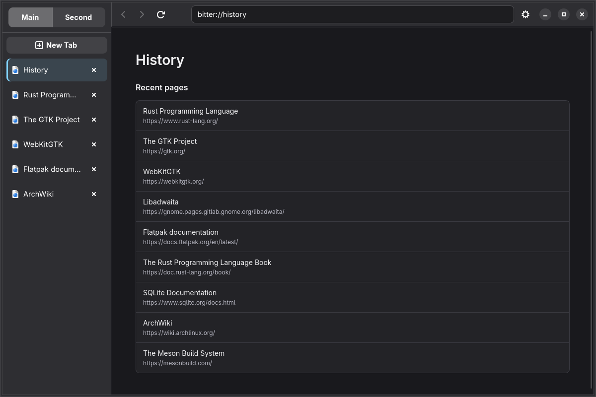
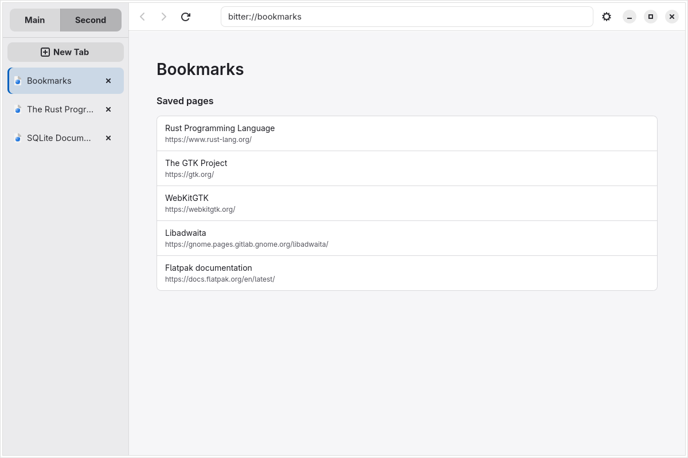
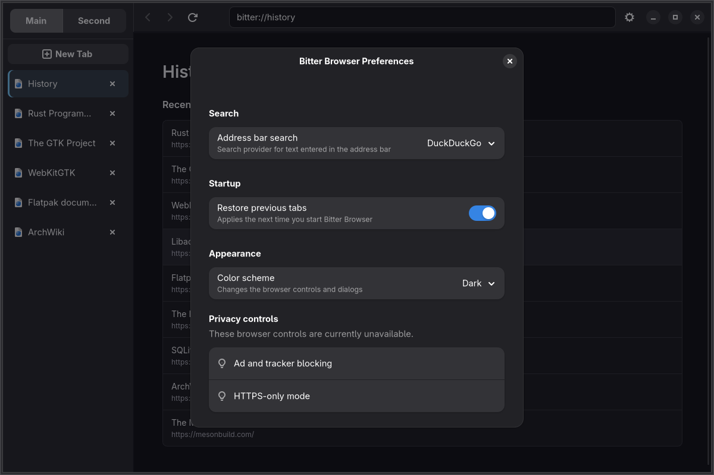

<p align="center">
  
</p>

<p align="center">
  <a href="https://github.com/bernardopg/bitter-browser/actions/workflows/ci.yml"></a>
  <a href="https://github.com/bernardopg/bitter-browser/actions/workflows/codeql.yml"></a>
  <a href="https://github.com/bernardopg/bitter-browser/releases/latest"></a>
  <a href="LICENSE"></a>
  
  
  <a href="https://github.com/sponsors/bernardopg"></a>
</p>

<p align="center">
  <a href="#install"><b>Install</b></a> ·
  <a href="#features"><b>Features</b></a> ·
  <a href="#build-from-source"><b>Build</b></a> ·
  <a href="#documentation"><b>Docs</b></a> ·
  <a href="TASKS.md"><b>Roadmap</b></a> ·
  <a href="#support"><b>Support</b></a>
</p>

<p align="center">
  
</p>

Bitter Browser is a web browser for the Linux desktop, built with Rust, GTK 4,
libadwaita and WebKitGTK 6. Tabs live in a vertical sidebar, split across two
workspaces, and the interface follows the GNOME design language.

> [!WARNING]
> Bitter Browser is **experimental** and not ready for sensitive browsing.
> Ad and tracker blocking and HTTPS-only mode are not available yet. Read the
> [security policy](SECURITY.md) and the [roadmap](TASKS.md) before relying on it.

## Features

| | |
| --- | --- |
| **Workspaces** | *Main* and *Second* keep their own tab order and selected tab. |
| **Session restore** | Reopens your tabs after a normal exit or a crash, and loads only the selected tab at startup. |
| **Smart address bar** | Suggestions from local history, bookmarks and open tabs, queried off the UI thread. |
| **Navigation feedback** | Loading progress, Stop, and native error pages with *Try Again*. |
| **Tab control** | Reopen closed tabs, reorder from the keyboard, open links in the background. |
| **Desktop integration** | Opens links from other applications in the running window. |
| **Native preferences** | Search provider, color scheme and startup behavior, saved immediately and atomically. |
| **Local data** | SQLite history and bookmarks with versioned migrations and a locked XDG profile. |

<table>
  <tr>
    <td width="50%"></td>
    <td width="50%"></td>
  </tr>
  <tr>
    <td align="center"><sub>Bookmarks · light color scheme</sub></td>
    <td align="center"><sub>Native preferences</sub></td>
  </tr>
</table>

## Install

### Flatpak

Download the x86-64 bundle from the
[latest release](https://github.com/bernardopg/bitter-browser/releases/latest)
and verify it against the published `sha256.txt` file. Then install the GNOME
runtime and the bundle:

```sh
flatpak install --user flathub org.gnome.Platform//51
flatpak install --user ./bitter-browser-0.1.1-x86_64.flatpak
flatpak run com.bitterbrowser.Browser
```

The file name changes with each release.

### Arch Linux

The repository ships a `PKGBUILD` that builds the latest commit:

```sh
git clone https://github.com/bernardopg/bitter-browser.git
cd bitter-browser
makepkg -si
```

## Keyboard shortcuts

| Action | Shortcut |
| --- | --- |
| New tab · close tab · reopen closed tab | <kbd>Ctrl</kbd>+<kbd>T</kbd> · <kbd>Ctrl</kbd>+<kbd>W</kbd> · <kbd>Ctrl</kbd>+<kbd>Shift</kbd>+<kbd>T</kbd> |
| Next or previous tab | <kbd>Ctrl</kbd>+<kbd>Page Down</kbd> · <kbd>Ctrl</kbd>+<kbd>Page Up</kbd> |
| Move tab | <kbd>Alt</kbd>+<kbd>Shift</kbd>+<kbd>←</kbd> · <kbd>Alt</kbd>+<kbd>Shift</kbd>+<kbd>→</kbd> |
| Address bar · command palette | <kbd>Ctrl</kbd>+<kbd>L</kbd> · <kbd>Ctrl</kbd>+<kbd>K</kbd> |
| Back · forward · reload | <kbd>Alt</kbd>+<kbd>←</kbd> · <kbd>Alt</kbd>+<kbd>→</kbd> · <kbd>Ctrl</kbd>+<kbd>R</kbd> |
| History · bookmarks · bookmark page | <kbd>Ctrl</kbd>+<kbd>H</kbd> · <kbd>Ctrl</kbd>+<kbd>B</kbd> · <kbd>Ctrl</kbd>+<kbd>D</kbd> |
| Preferences · quit | <kbd>Ctrl</kbd>+<kbd>,</kbd> · <kbd>Ctrl</kbd>+<kbd>Q</kbd> |

See [daily browsing](docs/daily-browsing.md) for the full list.

## Build from source

**Requirements:** stable Rust with rustfmt and Clippy, GTK ≥ 4.14,
libadwaita ≥ 1.6, WebKitGTK 6 ≥ 2.44 and their development headers. Meson and
Ninja are needed to install.

```sh
cargo run --locked -p bitter-ui             # run the browser
cargo test --workspace --locked             # unit and integration tests
cargo fmt --all -- --check                  # formatting
cargo clippy --workspace --all-targets --locked
```

Install system-wide with Meson:

```sh
meson setup builddir
meson compile -C builddir
meson install -C builddir
```

The browser needs a graphical session. The end-to-end WebKit smoke test runs
under Xvfb; see [daily browsing](docs/daily-browsing.md#verification).

## Documentation

| Guide | Covers |
| --- | --- |
| [Daily browsing](docs/daily-browsing.md) | Shortcuts, workspaces, suggestions, smoke test and startup baseline |
| [Profiles and local data](docs/profile.md) | File locations, migrations, session restore and recovery |
| [Architecture](docs/architecture.md) | Crate layout and current scope |
| [CI and releases](docs/ci-release.md) | Checks, coverage and the release process |
| [Roadmap](TASKS.md) | Production readiness plan |

## Contributing

Contributions are welcome. Read the [contributing guide](CONTRIBUTING.md) and
the [code of conduct](CODE_OF_CONDUCT.md), then open an
[issue](https://github.com/bernardopg/bitter-browser/issues) or start a
[discussion](https://github.com/bernardopg/bitter-browser/discussions) before
large changes. Report vulnerabilities privately as described in
[SECURITY.md](SECURITY.md). Project decisions follow [GOVERNANCE.md](GOVERNANCE.md).

## Support

If Bitter Browser is useful to you, consider supporting its development:

<p>
  <a href="https://github.com/sponsors/bernardopg"></a>
  <a href="https://ko-fi.com/bernardopg"></a>
  <a href="https://buymeacoffee.com/wctwom9emu"></a>
</p>

## License

Bitter Browser is licensed under the [Mozilla Public License 2.0](LICENSE).
