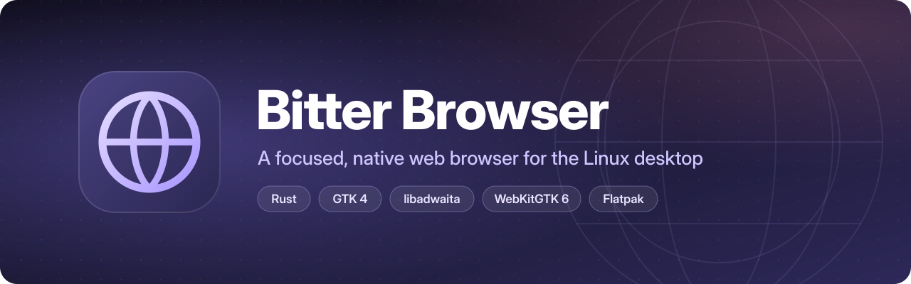
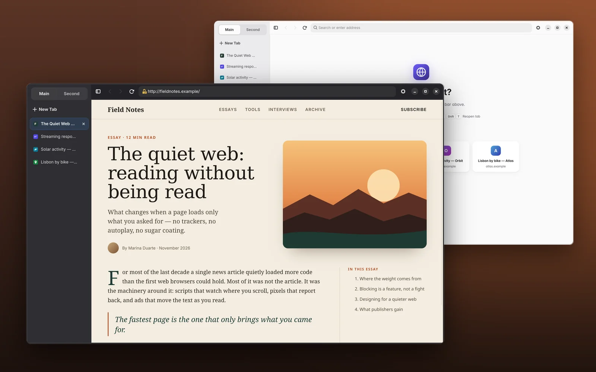
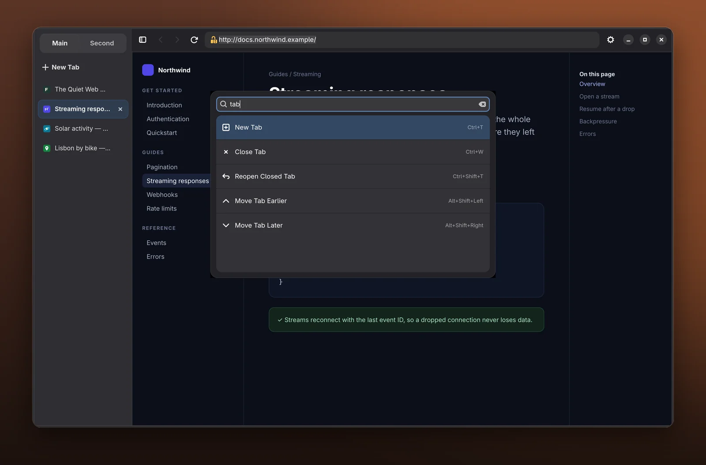
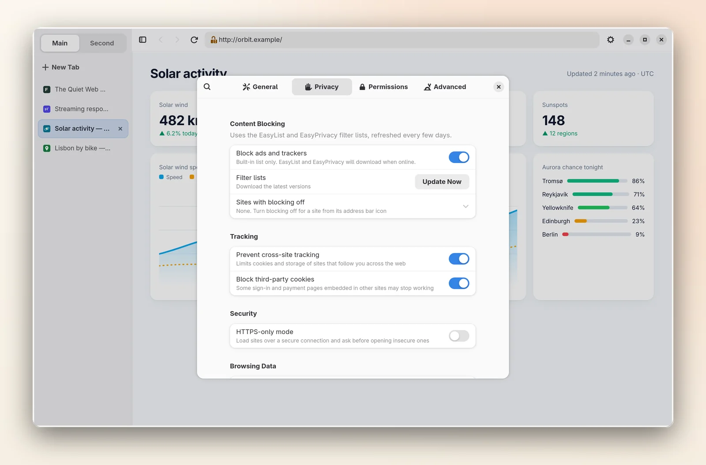

<p align="center">
  
</p>

<p align="center">
  <a href="https://github.com/bernardopg/bitter-browser/actions/workflows/ci.yml"></a>
  <a href="https://github.com/bernardopg/bitter-browser/actions/workflows/codeql.yml"></a>
  <a href="https://github.com/bernardopg/bitter-browser/releases/latest"></a>
  <a href="LICENSE"></a>
  
  
  <a href="https://github.com/sponsors/bernardopg"></a>
</p>

<p align="center">
  <a href="#install"><b>Install</b></a> ·
  <a href="#features"><b>Features</b></a> ·
  <a href="#build-from-source"><b>Build</b></a> ·
  <a href="#documentation"><b>Docs</b></a> ·
  <a href="TASKS.md"><b>Roadmap</b></a> ·
  <a href="#support"><b>Support</b></a>
</p>

<p align="center">
  
</p>

Bitter Browser is a web browser for the Linux desktop, built with Rust, GTK 4,
libadwaita and WebKitGTK 6. Tabs live in a vertical sidebar, split across two
workspaces, and the interface follows the GNOME design language.

> [!WARNING]
> Bitter Browser is **experimental** and has not had an independent security
> review. Read the [security policy](SECURITY.md) and the [roadmap](TASKS.md)
> before relying on it for sensitive browsing.

## Features

| | |
| --- | --- |
| **Workspaces** | *Main* and *Second* keep their own tab order and selected tab. |
| **Session restore** | Reopens your tabs after a normal exit or a crash, and loads only the selected tab at startup. |
| **Smart address bar** | Suggestions from local history, bookmarks and open tabs, queried off the UI thread. |
| **Navigation feedback** | Loading progress, Stop, and native error pages with *Try Again*. |
| **Tab control** | Reopen closed tabs, reorder from the keyboard, open links in the background, site icons. |
| **Downloads** | Saved to your downloads folder under safe, unique names, or where you choose, with progress, cancel and open. |
| **Page tools** | Find in page, per-site zoom, printing and full screen for the browser, videos and pages. |
| **Sign-in pop-ups** | Pages opened with `window.open` become tabs that keep `window.opener`, so "Sign in with…" and payment windows work. |
| **Site permissions** | Sites ask before using notifications, location, camera, microphone or the clipboard; answers are remembered per site and can be changed from the address bar or preferences. |
| **Content blocking** | Blocks ads and trackers with EasyList and EasyPrivacy, compiled by WebKit and refreshed every few days, with a per-site switch. |
| **HTTPS-only mode** | Loads sites over HTTPS and asks before opening a site that has no secure version. |
| **Privacy controls** | Cross-site tracking prevention, third-party cookie blocking and clearing history, cookies, cache and downloads by time range, or single pages from the History page. |
| **Context menu** | Open links and images in a new or background tab, and search the selected text. Hovered links show their address. |
| **Developer tools** | Web Inspector with F12, Ctrl+Shift+I or Inspect Element. |
| **Desktop integration** | Opens links from other applications in the running window; `bitter-cli` launches it from scripts and terminals. |
| **Native preferences** | General, privacy, permissions and advanced pages, saved immediately and atomically. |
| **Local data** | SQLite history and bookmarks with versioned migrations and a locked XDG profile. |

<table>
  <tr>
    <td width="50%"></td>
    <td width="50%"></td>
  </tr>
  <tr>
    <td align="center"><sub>Command palette · Ctrl+K</sub></td>
    <td align="center"><sub>Privacy on by default</sub></td>
  </tr>
</table>

## Install

```sh
curl -fsSL https://browser.bebitterbebetter.com.br/install.sh | sh
```

The installer picks the native package for your distribution and checks its
SHA-256 checksum before installing. Or choose a channel:

| System | Command |
| --- | --- |
| Arch Linux (AUR) | `yay -S bitter-browser` (source) or `yay -S bitter-browser-bin` (prebuilt) |
| Arch Linux (pacman) | [add the signed repository](docs/distribution.md#arch-linux-pacman-repository), then `sudo pacman -S bitter-browser` |
| Debian 13, Ubuntu 25.10+, Linux Mint 23 | `sudo apt install ./bitter-browser_0.6.0-1_amd64.deb` |
| Fedora 43+ | `sudo dnf install ./bitter-browser-0.6.0-1.fc44.x86_64.rpm` |
| Any distribution with Flatpak | `flatpak install --user ./bitter-browser-0.6.0-x86_64.flatpak` |
| Other x86-64 Linux (glibc 2.41+) | `bitter-browser-0.6.0-linux-x86_64.tar.xz`, then `./install.sh` |

Packages are on every [release](https://github.com/bernardopg/bitter-browser/releases/latest),
with a checksum file, an SPDX SBOM and GitHub build provenance attestations:

```sh
sha256sum -c --ignore-missing bitter-browser-0.6.0-sha256.txt
gh attestation verify bitter-browser-0.6.0-x86_64.flatpak --repo bernardopg/bitter-browser
```

To make Bitter Browser your default browser, open **Preferences > General >
Default browser** or run
`xdg-settings set default-web-browser br.com.bebitterbebetter.browser.Bitter.desktop`.
[Distribution and desktop integration](docs/distribution.md) covers each
distribution and desktop (GNOME, KDE Plasma, Xfce, Cinnamon, MATE), upgrades
from the old `com.bitterbrowser.Browser` ID and uninstalling.

## Keyboard shortcuts

| Action | Shortcut |
| --- | --- |
| New tab · close tab · reopen closed tab | <kbd>Ctrl</kbd>+<kbd>T</kbd> · <kbd>Ctrl</kbd>+<kbd>W</kbd> · <kbd>Ctrl</kbd>+<kbd>Shift</kbd>+<kbd>T</kbd> |
| Next or previous tab | <kbd>Ctrl</kbd>+<kbd>Page Down</kbd> · <kbd>Ctrl</kbd>+<kbd>Page Up</kbd> |
| Move tab | <kbd>Alt</kbd>+<kbd>Shift</kbd>+<kbd>←</kbd> · <kbd>Alt</kbd>+<kbd>Shift</kbd>+<kbd>→</kbd> |
| Address bar · command palette | <kbd>Ctrl</kbd>+<kbd>L</kbd> · <kbd>Ctrl</kbd>+<kbd>K</kbd> |
| Back · forward · reload | <kbd>Alt</kbd>+<kbd>←</kbd> · <kbd>Alt</kbd>+<kbd>→</kbd> · <kbd>Ctrl</kbd>+<kbd>R</kbd> |
| Find · next · previous | <kbd>Ctrl</kbd>+<kbd>F</kbd> · <kbd>Ctrl</kbd>+<kbd>G</kbd> · <kbd>Ctrl</kbd>+<kbd>Shift</kbd>+<kbd>G</kbd> |
| Zoom in · out · reset | <kbd>Ctrl</kbd>+<kbd>+</kbd> · <kbd>Ctrl</kbd>+<kbd>-</kbd> · <kbd>Ctrl</kbd>+<kbd>0</kbd> |
| Full screen · downloads | <kbd>F11</kbd> · <kbd>Ctrl</kbd>+<kbd>J</kbd> |
| History · bookmarks · bookmark page | <kbd>Ctrl</kbd>+<kbd>H</kbd> · <kbd>Ctrl</kbd>+<kbd>B</kbd> · <kbd>Ctrl</kbd>+<kbd>D</kbd> |
| Preferences · quit | <kbd>Ctrl</kbd>+<kbd>,</kbd> · <kbd>Ctrl</kbd>+<kbd>Q</kbd> |

See [daily browsing](docs/daily-browsing.md) for the full list.

## Build from source

**Requirements:** stable Rust with rustfmt and Clippy, GTK ≥ 4.14,
libadwaita ≥ 1.6, WebKitGTK 6 ≥ 2.44 and their development headers. Meson and
Ninja are needed to install.

```sh
cargo run --locked -p bitter-ui             # run the browser
cargo test --workspace --locked             # unit and integration tests
cargo fmt --all -- --check                  # formatting
cargo clippy --workspace --all-targets --locked
```

Install system-wide with Meson:

```sh
meson setup builddir
meson compile -C builddir
meson install -C builddir
```

This installs `bitter-ui` and the `bitter-cli` launcher.

The browser needs a graphical session. The end-to-end WebKit smoke test runs
under Xvfb; see [daily browsing](docs/daily-browsing.md#verification).

## Documentation

| Guide | Covers |
| --- | --- |
| [Daily browsing](docs/daily-browsing.md) | Shortcuts, workspaces, suggestions, smoke test and startup baseline |
| [Profiles and local data](docs/profile.md) | File locations, migrations, session restore and recovery |
| [Architecture](docs/architecture.md) | Crate layout and current scope |
| [Component inventory](docs/components.md) | Ownership, runtime dependencies, local state and entry points |
| [Release and support contract](docs/support.md) | Target platforms, runtime policy, defaults and production criteria |
| [Brand book](branding/README.md) | Logo, app icon, colors, typography, slogan, campaign assets and press kit |
| [Distribution and desktop integration](docs/distribution.md) | Install channels, supported distributions and desktops, default browser, packaging pipeline and secrets |
| [CI and releases](docs/ci-release.md) | Checks, coverage, branch cleanup and the release process |
| [Agent instructions](AGENTS.md) | Checks, tokensave, Headroom memory, branch cleanup and release check records |
| [Roadmap](TASKS.md) | Production readiness plan |

## Contributing

Contributions are welcome. Read the [contributing guide](CONTRIBUTING.md) and
the [code of conduct](CODE_OF_CONDUCT.md), then open an
[issue](https://github.com/bernardopg/bitter-browser/issues) or start a
[discussion](https://github.com/bernardopg/bitter-browser/discussions) before
large changes. Report vulnerabilities privately as described in
[SECURITY.md](SECURITY.md). Project decisions follow [GOVERNANCE.md](GOVERNANCE.md).

## Support

If Bitter Browser is useful to you, consider supporting its development:

<p>
  <a href="https://github.com/sponsors/bernardopg"></a>
  <a href="https://ko-fi.com/bernardopg"></a>
  <a href="https://buymeacoffee.com/wctwom9emu"></a>
</p>

## License

Bitter Browser is licensed under the [Mozilla Public License 2.0](LICENSE).
