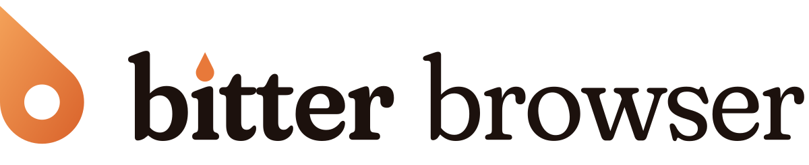
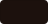
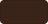
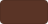
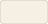
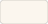

# Bitter Browser brand

The brand book for Bitter Browser: what the brand stands for, how the logo,
color and type work, and the assets for the app, the website and campaigns.
Every asset in this folder is generated by [`build.py`](build.py); change
the code, not the exported files.

```sh
python3 branding/build.py      # regenerates logos, icons, social images and the README banner
```

The build also writes the application icons in
`crates/bitter-ui/data/icons/hicolor/` and `docs/assets/banner.svg`.

## Essence

| | |
| --- | --- |
| **Slogan** | *The web, unsweetened.* |
| **Tagline** | *Be bitter. Browse better.* |
| **Promise** | The web as it is, without sugar-coated tracking, ads or noise, in a browser that feels native to the Linux desktop. |
| **Audience** | Linux users who choose their tools with care: developers, writers and privacy-minded people on GNOME, KDE Plasma and tiling desktops. |
| **Personality** | Honest, focused, warm, crafted. Never cynical, never loud. |

**Why "bitter".** Bitterness is the taste of things that are good for you
and have not been sweetened to please: dark chocolate, espresso, aromatic
bitters. Bitter Browser takes out the additives (trackers, ads, dark
patterns) and keeps what matters. The name also echoes the owner's motto,
*Be Bitter, Be Better* (bebitterbebetter.com.br).

### Voice

Short, direct sentences. Concrete facts instead of superlatives. A dry,
confident wit that comes from the bitter metaphor, used sparingly.

| Do | Avoid |
| --- | --- |
| "Ads and trackers blocked. Nothing added." | "The most amazing privacy experience ever!" |
| "Tabs in a sidebar, in two workspaces." | "Revolutionary tab management." |
| "Native GTK 4. Starts fast, feels at home." | "Blazing-fast next-gen browsing." |

Campaign lines: *Zero added trackers.* · *No sugar-coated ads.* · *Taste the
real web.* · *A browser with a clean finish.* · *Less sugar. More web.*

## Logo



### The mark

A lowercase **b** drawn as a **drop of bitters**. The stem of the b is the
straight side of the drop, its point is the top of the stem, and the other
side is the tangent from that point to the round bowl. The counter (the hole
of the b) is centered in the bowl. It is built from one circle, one point
and two tangents, so it stays exact at every size.

The same drop dots the *i* in the wordmark, in Bitter Orange.

| Asset | Use |
| --- | --- |
| [`logo/mark.svg`](logo/mark.svg) | Default mark, orange gradient, on espresso or cream |
| [`logo/mark-espresso.svg`](logo/mark-espresso.svg) | One color on light backgrounds |
| [`logo/mark-paper.svg`](logo/mark-paper.svg) | One color on dark backgrounds and photos |
| [`logo/mark-black.svg`](logo/mark-black.svg) | Print in one ink, engraving, embossing |
| [`logo/lockup.svg`](logo/lockup.svg), [`lockup-paper.svg`](logo/lockup-paper.svg) | Horizontal lockup on light and dark |
| [`logo/lockup-espresso.svg`](logo/lockup-espresso.svg) | One-color horizontal lockup |
| [`logo/lockup-stacked.svg`](logo/lockup-stacked.svg), [`lockup-stacked-paper.svg`](logo/lockup-stacked-paper.svg) | Square spaces, posters, splash screens |
| [`logo/wordmark.svg`](logo/wordmark.svg), [`wordmark-paper.svg`](logo/wordmark-paper.svg) | When the mark already appears nearby |

PNG exports (1200 px wide) are in [`logo/png/`](logo/png/).

### Clear space and minimum size

- Keep a margin of at least the counter's diameter around the mark, and the
  height of the *b* around the lockup.
- Minimum sizes: mark 16 px (use the app icon below 24 px), horizontal
  lockup 120 px wide, stacked lockup 80 px wide.

### Don't

- Don't rotate, flip, stretch or outline the mark.
- Don't recolor the drop on the *i* except in the one-color versions.
- Don't put the orange mark on orange or on busy photos; use the paper
  version.
- Don't set "Bitter Browser" in another typeface as a logo.
- Don't add effects other than those in the app icon.

## Color

| Swatch | Name | Hex | Use |
| --- | --- | --- | --- |
|  | Espresso | `#1C110D` | Ink, dark backgrounds, text on light |
|  | Roast | `#3A2419` | Dark surfaces, gradients |
|  | Cacao | `#5A3426` | Gradient highlight on dark |
|  | Bitter Orange | `#E8793A` | The drop, calls to action, highlights |
|  | Amber | `#F4A259` | Gradient start, accents on dark |
|  | Zest | `#D9622B` | Gradient end, pressed states |
|  | Cream | `#F6EFE3` | Light backgrounds |
|  | Paper | `#FBF6EE` | Lightest surface, text on dark |
|  | Gentian | `#2F5D50` | Secondary accent for privacy and success cues, sparingly |

Proportion: about 60% espresso or cream, 30% roast, cacao and paper, 10%
orange. The orange gradient runs from Amber (top left) to Zest (bottom
right). Tokens: [`tokens/colors.json`](tokens/colors.json) and
[`tokens/brand.css`](tokens/brand.css).

**Contrast (WCAG 2.2).** Paper on espresso 17.2:1, espresso on cream 16.2:1,
Bitter Orange on espresso 6.4:1, Amber on espresso 9.0:1, espresso text on an
orange button 6.4:1, Gentian on cream 6.6:1. Bitter Orange on cream is only
2.5:1 and Zest on cream 3.2:1: on light backgrounds use orange for graphics
and large display type, never for body text or links (use espresso text with
an orange underline).

## Typography

| Role | Typeface | Settings |
| --- | --- | --- |
| Display, logo, headlines | [Fraunces](https://fonts.google.com/specimen/Fraunces) | Weight 600 (bitter) and 380 (browser, headlines), optical size 144, `SOFT` 100, `WONK` 0 |
| Text and interface | [Inter](https://rsms.me/inter/) | Weight 400–650, `opsz` automatic |
| Code and commands | [JetBrains Mono](https://www.jetbrains.com/lp/mono/) | Weight 400–500 |

All three are under the SIL Open Font License. The logos are outlined, so
they never need the fonts installed. In the browser's own interface, text
follows the GNOME system font.

## Icons

| Asset | Use |
| --- | --- |
| [`icon/app-icon.svg`](icon/app-icon.svg) | Application icon (hicolor scalable), espresso tile with the orange mark and a soft top sheen, following the GNOME app icon style |
| [`icon/app-icon-symbolic.svg`](icon/app-icon-symbolic.svg) | Symbolic icon (16 px grid) for panels and switchers; GTK recolors it |
| [`icon/favicon.svg`](icon/favicon.svg), [`favicon.ico`](icon/favicon.ico) | Website favicon (16, 32, 48 px in the .ico) |
| [`icon/apple-touch-icon.png`](icon/apple-touch-icon.png), [`icon-192.png`](icon/icon-192.png), [`icon-512.png`](icon/icon-512.png) | Home-screen and web app icons |
| [`icon/app-icon-1024.png`](icon/app-icon-1024.png) | Store listings and press |

Interface icons inside the browser are GNOME's symbolic icons, so the
browser matches the desktop. Do not draw custom UI icons in the brand style.

## Imagery

### Product screenshots

The screenshots are captured from the real browser, not mocked up:

```sh
cargo build -p bitter-ui --locked          # or use the installed /usr/bin/bitter-ui
scripts/headless-session.sh --screen 3000x1900x24 -- \
  python3 branding/screenshots/capture.py /usr/bin/bitter-ui
python3 branding/screenshots/compose.py
```

`capture.py` starts the browser at 2× scale (2880×1800) with a fresh
profile, a prepared session and history, and serves six demo sites from
`branding/screenshots/sites/` through a local proxy under `.example` names,
so no request leaves the machine and no third-party brand appears.
`compose.py` writes the framed website images to `site/assets/screens/`
(WebP, 1600 and 2400 px) and the plain windows for the README and the
AppStream metainfo to `docs/assets/screenshots/`. Rebuild the social images
afterwards with `branding/build.py`, which embeds `reading-dark.png`.

### Style


- Show the real product: screenshots framed as a floating window with a
  soft shadow, on the espresso field with a warm orange glow.
- Photography, when used: macro, warm, low-key light; dark roasted textures
  (espresso, cacao, citrus peel, amber glass). No candy, no sugar imagery
  except to contrast "unsweetened".
- Never show third-party logos or real people without permission.

## Campaign assets

| File | Size | For |
| --- | --- | --- |
| [`social/og-image.png`](social/og-image.png) | 1200 × 630 | Link previews (Open Graph, Mastodon, Matrix, Discord) |
| [`social/github-social-preview.png`](social/github-social-preview.png) | 1280 × 640 | GitHub repository social preview |
| [`social/x-header.png`](social/x-header.png) | 1500 × 500 | X / Twitter header (content right of the avatar) |
| [`social/linkedin-banner.png`](social/linkedin-banner.png) | 1584 × 396 | LinkedIn banner |
| [`social/instagram-post.png`](social/instagram-post.png) | 1080 × 1080 | Square posts |
| [`social/instagram-story.png`](social/instagram-story.png) | 1080 × 1920 | Stories and Reels covers |

Each PNG has an SVG source beside it.

## Press

**Boilerplate (50 words).** Bitter Browser is an open-source web browser for
Linux, written in Rust with GTK 4, libadwaita and WebKitGTK. It keeps tabs in
a vertical sidebar organized in two workspaces, blocks ads and trackers by
default, and installs on Arch, Debian, Ubuntu, Fedora and any Flatpak
system. *The web, unsweetened.*

- Website: <https://browser.bebitterbebetter.com.br/>
- Source: <https://github.com/bernardopg/bitter-browser> (MPL-2.0)
- Media kit: <https://browser.bebitterbebetter.com.br/brand/>

The brand assets are © Bitter Browser Contributors. Use them to refer to the
project; don't use them to imply endorsement or for another product.
